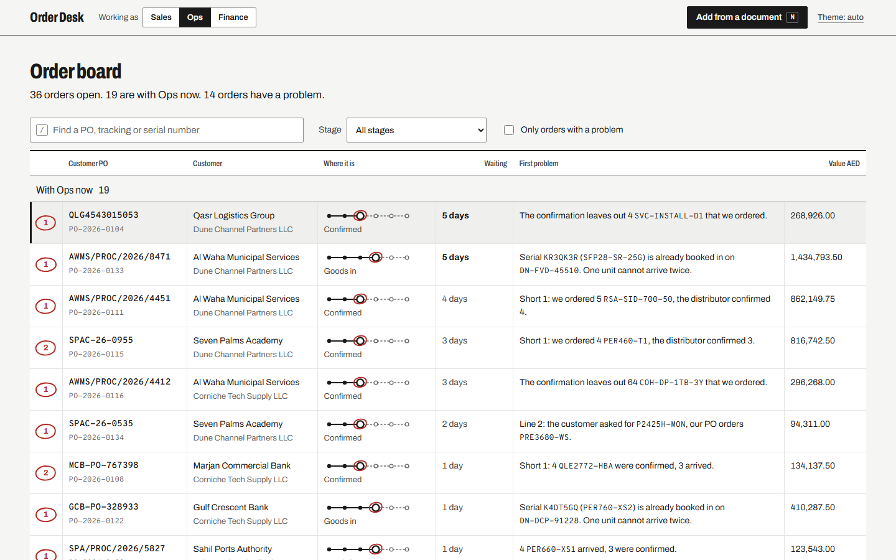
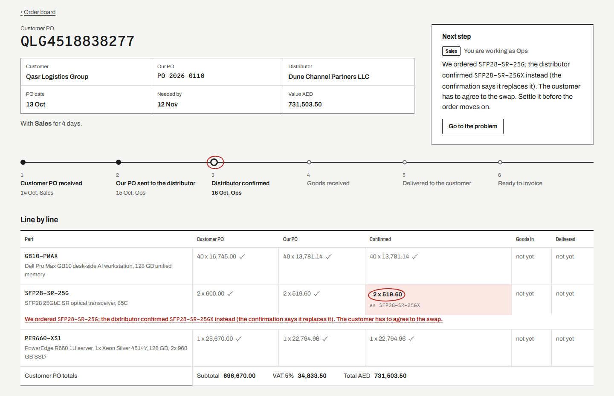

# Order Desk

Every customer order as one chain, from the customer's PO to "ready to invoice": who has to act next, documents
read straight into the order with the place each value came from, and a line-by-line check that says in plain
words what does not match.

**Live demo:** https://order-desk-ops.vercel.app (made-up companies and orders; the data resets every night)



## The problem it solves

At an IT reseller, one order passes through four documents written by three companies: the customer's purchase
order, our PO to the distributor, the distributor's confirmation, and the delivery note or dispatch email when
the goods arrive. Each is typed in by hand and compared by eye. The mistakes that cost money hide in those
comparisons: one server short, a substitute part nobody approved, a price that went up 12%, a serial number
that was already booked in on another order, VAT printed at 50% instead of 5%.

| Before | With Order Desk |
|---|---|
| Re-type every PO, confirmation and delivery note | Drop the PDF or the email: fields and lines are read, with a box on the page showing where each value came from |
| Compare four documents line by line by eye | 14 checks run on every save; each problem is one sentence with the numbers in it ("Short 1: we ordered 5 RSA-SID-700-50, the distributor confirmed 4.") |
| "Who has this order?" asked in chat | The board puts your orders first: switch between Sales, Ops and Finance and the board reorders |
| Decisions lost in email threads | Accepting or fixing a problem needs a note; every change is in the order's history with who did it |

## What is in it

- **Board** (`/`): every order with its six steps as a route line, whose turn it is, how long it has waited and
  its first problem. Search by PO, tracking or serial number. Keyboard: `/`, `j` `k`, `Enter`, `N`.
- **Order** (`/orders/:id`): the next step in words with the action for it (place our PO, book in goods, deliver,
  hand to finance), the line-by-line grid with every value that does not match circled and explained, problems
  settled inline with a note, the documents with their source boxes, serial numbers and the full history.
- **Add from a document** (`/intake`): PDF purchase orders, distributor confirmations, delivery notes, and
  `.eml` dispatch emails (serials in the body or as a CSV attachment). Values the reader is unsure of are marked
  "Check" and focused first. Nothing is saved until a person confirms. Six sample documents are offered.



## Measured, not claimed

All numbers come from [`eval/results.json`](eval/results.json) and [`eval/baseline-v1.0.json`](eval/baseline-v1.0.json),
regenerated by `python -m eval.run_eval` and checked for drift in CI.

The test set is synthetic: 42 orders, 161 documents, five purchase-order layouts, two distributor layouts,
delivery notes and dispatch emails, with 33 problems of all 14 kinds planted on purpose. **I wrote both the
documents and the reader, so the numbers below say the reader handles these layouts, not that it handles any
PDF in the wild.**

| | Header fields | Line items |
|---|---|---|
| Layouts used to write the reader (119 documents) | 100% | 100% |
| **Held-out layout, first try (version 1.0, 42 documents)** | **14.3% (42 of 294)** | **100% (120 of 120)** |
| Held-out layout after generic fixes (version 1.1) | 100% | 100% |

The held-out layout was kept away from the reader while it was written. Its first score is the honest one: the
table reading carried over, the labels did not ("Order No.", "Dated", "Amount Payable" were not in the
vocabulary). Version 1.1 adds rules that hold for any PO (a short label ending in "No." before an identifier;
the earlier date is the order date, the later one the delivery date; money with no part number ends the table).
Values found this way get low confidence, so the screen marks them "Check". Because those fixes were made after
seeing the held-out failures, its 1.1 score is no longer a clean test. A test fails if any of the held-out
layout's own labels ever enters the vocabulary.

**Check engine:** all 33 planted problems found, 0 false alarms, both on the true order data and end to end (the
documents read back by the reader first). Each of the 14 rules also has its own passing and failing unit test.

## How it works

```
PDF / .eml  ->  reader (pdfplumber words + positions)  ->  you confirm  ->  Postgres  ->  14 checks  ->  board
                every value keeps its page box                              triggers write the history
```

- **Reader** ([`backend/extract`](backend/extract)): no model and no template per sender. Header values are
  found to the right of a label or in the box under it; the line-item table starts at a row of column headings and
  each figure is filed under the heading it lines up with; quantity x price is cross-checked against the line
  amount. Emails: carrier tracking patterns, serial lists from the body or an attached CSV. File type is decided
  from the first bytes, not the name.
- **Checks** ([`backend/check/engine.py`](backend/check/engine.py)): pure functions over the order chain. Lines are
  matched by part number, then a stated substitute ("replaces X"), then a similar description (rapidfuzz). Each
  problem has a stable fingerprint, so checking again keeps a problem someone accepted accepted.
- **Database** ([`backend/db/migrations`](backend/db/migrations)): Postgres with numbered migrations, a checksum so
  an applied migration is never edited, and rules the database enforces itself: a TRN must be 15 digits starting
  100, quantities above zero, the same file can never be added twice, a serial number arrives once and leaves
  once, a PO can only go to a distributor. Every change to an order is written to an `event` table by triggers,
  with the role that made it. The board is a view (`order_chain`, `board`): stage, whose turn and days waiting
  are computed, never stored.
- **API** ([`backend/api`](backend/api)): Flask, one short connection per request (serverless), uploads kept in
  Postgres between "read" and "confirm" (instances share no disk), a per-visitor write limit stored in the
  database, one error shape.
- **Web** ([`web`](web)): React, Vite, TypeScript, plain CSS. pdf.js renders the document and draws the source
  boxes; it loads only on the order and intake pages.

## Run it

```bash
python -m venv .venv && .venv/Scripts/pip install -r requirements-dev.txt   # Python 3.14
# a Postgres database: copy .env.example to .env and fill DATABASE_URL_UNPOOLED (and DATABASE_URL_TEST for tests)
python -m backend.db.migrate
ORDER_DESK_RESET_HOST=<your db host> python -m backend.db.seed --reset      # 42 orders, 119 documents, history
python -m flask --app app run -p 5181
npm --prefix web ci && npm --prefix web run dev                             # http://127.0.0.1:5180
```

Tests: `pytest` (71: database rules, reader, checks, seed, API), `npm --prefix web test` (10),
`npm --prefix web run e2e` (16 in a real browser, with axe accessibility checks in light and dark).
Regenerate the documents with `python -m synth.generate` and the scores with `python -m eval.run_eval`.

## Limits

- Synthetic documents and companies only; the reader has not been measured on real paperwork.
- Machine-made PDFs only: a scanned page has no text to read (no OCR).
- Classic Outlook `.msg` files are not read; save the email as `.eml`.
- The demo has no logins: you pick the role you work as, and anyone can add a document. Writes are rate limited,
  uploads are capped at 2 MB, and the database resets every night.
- One distributor PO per customer order.

Built by Uzair Khan. Design notes: [docs/design.md](docs/design.md).
